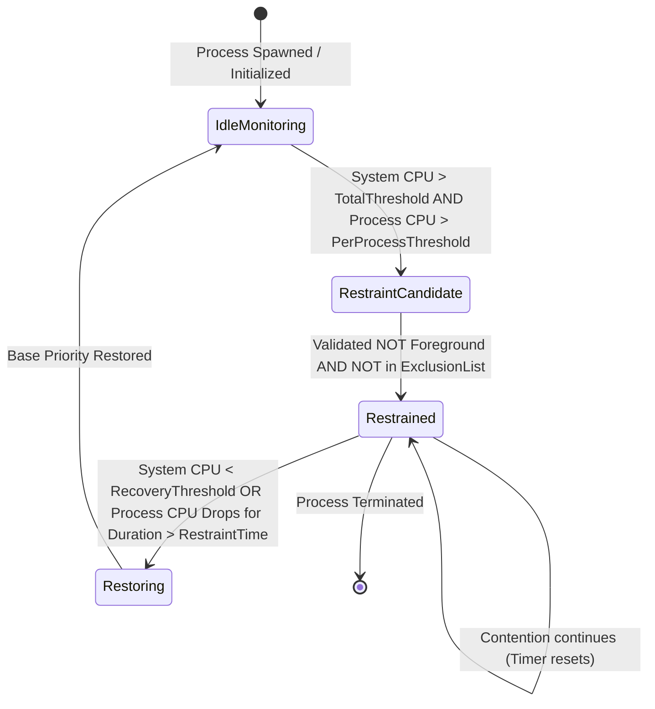

# ProBalance Specification: Algorithmic & State Machine Reference

## 1. The Core Problem: Thread Quantum Starvation
Under the standard Windows NT preemptive priority-based scheduler:
1. Threads of equal priority share CPU cycles via round-robin within their priority queue.
2. A single CPU-bound background process running multiple threads at `NORMAL_PRIORITY_CLASS` can monopolize the ready queues of available processor cores.
3. When the user interacts with the system (moving mouse, typing, playing audio), the foreground thread, Desktop Window Manager (`dwm.exe`), or Windows Audio Device Graph (`audiodg.exe`) experiences scheduling latency (jitter / micro-stutters) waiting for timeslices.

---

## 2. ProBalance State Machine

Each managed process PID traverses the following state transitions:

### State Definitions
- **`IdleMonitoring`**: Process runs at its user-defined or default Windows priority class.
- **`RestraintCandidate`**: System and process CPU metrics satisfy the trigger condition:
  $$\text{TotalCPU} \ge \theta_{\text{system}} \quad \land \quad \text{ProcCPU}_i \ge \theta_{\text{proc}}$$
- **`Restrained`**: The governor records original priority $\Pi_{\text{base}}$ and invokes `SetPriorityClass(hProcess, BELOW_NORMAL_PRIORITY_CLASS)`.
- **`Restoring`**: The recovery condition is met:
  $$\text{TotalCPU} < \theta_{\text{recovery}} \quad \text{for } t > \tau_{\text{cooldown}}$$
  The governor resets priority to $\Pi_{\text{base}}$.

---

## 3. Mathematical Heuristics

### 3.1. Process CPU Differential Formula
Given two successive process runtime snapshots at timestamps $t_1$ and $t_2$:
$$\Delta t = t_2 - t_1$$
$$\Delta T_{\text{kernel}} = \text{KernelTime}(t_2) - \text{KernelTime}(t_1)$$
$$\Delta T_{\text{user}} = \text{UserTime}(t_2) - \text{UserTime}(t_1)$$
$$\text{ProcCPU}\% = \min\left(100.0, \frac{\Delta T_{\text{kernel}} + \Delta T_{\text{user}}}{\Delta t \times N_{\text{cores}}} \times 100\right)$$

### 3.2. Restraint Eligibility Predicate
Let:
- $F$ be the PID of the foreground window process (`GetWindowThreadProcessId(GetForegroundWindow())`).
- $E$ be the set of excluded executable names (e.g. `System`, `audiodg.exe`, `dwm.exe`, `explorer.exe`).
- $P$ be the target process.

$$\text{Eligible}(P) \iff (P.\text{PID} \ne F) \land (P.\text{Name} \notin E) \land (\text{Priority}(P) > \text{BELOW\_NORMAL})$$

---

## 4. Parameter Tuning Defaults

| Parameter | Default Value | Description |
|:---|:---:|:---|
| `cpu_trigger_threshold_percent` | `65.0%` | Total system CPU usage required to trigger ProBalance |
| `per_process_cpu_trigger_percent` | `20.0%` | Single process CPU usage threshold |
| `target_restraint_priority` | `BELOW_NORMAL` | Priority applied during restraint |
| `restraint_duration_seconds` | `10 s` | Minimum duration of restraint before restoration check |
| `recovery_threshold_percent` | `50.0%` | System CPU level below which restraint starts clearing |
| `ignore_foreground_process` | `true` | Never throttle currently active foreground application |
